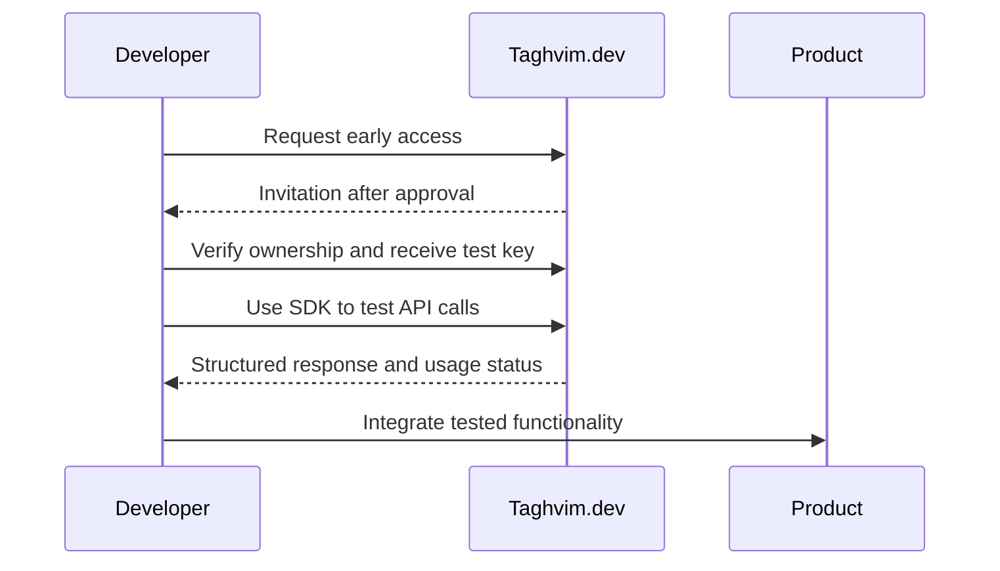

# Public API and SDK lifecycle

## Release states

| State | Meaning |
| --- | --- |
| Concept | Design and documentation only |
| Preview | Isolated tests or invitation access; API may change |
| Beta | Versioned contract, user-facing support and evidence |
| GA | Verified reliability, security, metering and published support policy |
| Deprecated | Version still supported until an announced sunset |

At the current audit, Taghvim.dev is in **early access**, not GA.

## Compatibility and evidence

Each SDK release must record the matching API contract version and checksum, test run URL, release commit, owner approval and rollback reference. Changes to requests, permissions, error fields or meter weights require contract tests, a compatibility assessment and explicit versioning.

Only user-visible contracts, capabilities and migration guidance belong in public documentation. Operational deployment details and subcontractor identities do not.

## Example user journey

