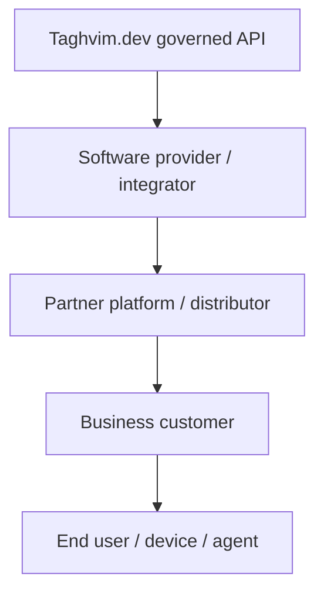

# Multi-party distribution — B2B2B2C design target

Taghvim.dev is designed to support **direct developers**, **technology resellers and partner platforms**, **downstream businesses**, and their **end users**. This is a target architecture, not proof that multi-level delegation and billing are fully deployed.

**Non-negotiables before general availability:** isolated tenant/subtenant identifiers; explicitly scoped delegated permissions; upstream and downstream meter attribution; no implicit inheritance of identity, data or keys; revoke at each boundary; signed traceable usage evidence; separate sandbox/live policies; clear service ownership.

Do not represent the consumer as the payer by default: a partner or business may pay on behalf of end-user traffic. Distributors can remain interoperable without a compulsory network or common customer database.
