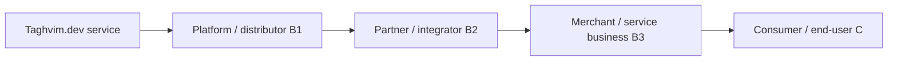

# Taghvim.dev as B2B2B2C infrastructure

**Product architecture direction:** multilevel distribution where the direct Taghvim account is a business; a distributor, tenant organization, downstream business and consumer can each represent an independent boundary.

## Required governance, not automatic inheritance

- Every actor uses explicit identity, consent and scoped permissions. Partner credentials do not convey unrestricted downstream authority.
- Business-level metering distinguishes `provider_tenant`, `distributor`, `partner`, `merchant`, `end_customer`, `environment`, `plan_version` and `bill_to` in the *governed internal data contract*. Do not expose customer identity to unrelated partners.
- Invoices and commercial balances must reconcile to durable immutable usage events, documented rate versions and accepted delegation.
- Revocation, dispute, reversals, refund events and usage corrections require independent audit records.
- No party's access to the end customer's personal data may be inferred from commercial placement.
- Multi-level billing, delegated keys, federation and partner-level settlement are **roadmap gates**. Existing tenant-scoped API keys alone do not prove this implementation.

## Suggested rollout

1. Direct B2B developer sandbox, test keys, consent and quota with real operational evidence.
2. B2B2C embedded widgets and delegated scopes for a single partner and consumer-facing flow.
3. B2B2B2C nested scopes, delegated invitations, sub-ledgers, settlements and revenue distribution, validated with negative isolation tests.

[SDK quickstart](DEVELOPER-QUICKSTART.md)
