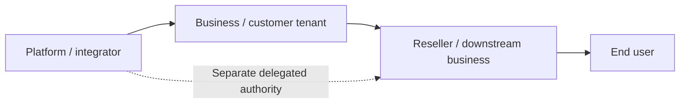

# B2B2B2C — intended distribution model

Taghvim.dev intends to serve software businesses (B), their client businesses (B), downstream distributors/merchants (B) and end consumers (C), including delegated agents.

**Verified code boundary (2026-10-20):** the engine supports first-class tenant identity, test/live API keys, plans, quota/metering and tenant-isolated usage. Its current canonical database has a `tenants` table and keys linked directly to one tenant. It does **not** yet establish a full first-class parent/child/federated tenant graph, cross-tenant delegated authority and revenue-sharing ledger for arbitrary B2B2B2C depth.

## Acceptance gates before calling it B2B2B2C-ready
- Stable identities for all business/end-user actors, relationships and products.
- Versioned delegation/grant/consent with revocation, isolation, scoped downstream key issuance.
- Usage attribution at platform, customer tenant, downstream business and permitted end-user levels (privacy-minimized), without charging twice.
- Distribution billing and settlement contracts, including cancellation, credits and refunds.
- Marketplace/widget and API embed attribution and isolation.
- Isolation/concurrency/fraud/payment/reconciliation end-to-end tests with explicit evidence.
- Durable execution, audit and rollback across business boundaries.

This page is an engineering roadmap, not a promise of a currently available service.
