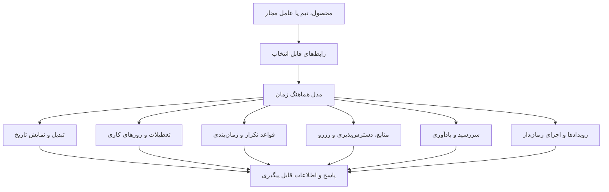
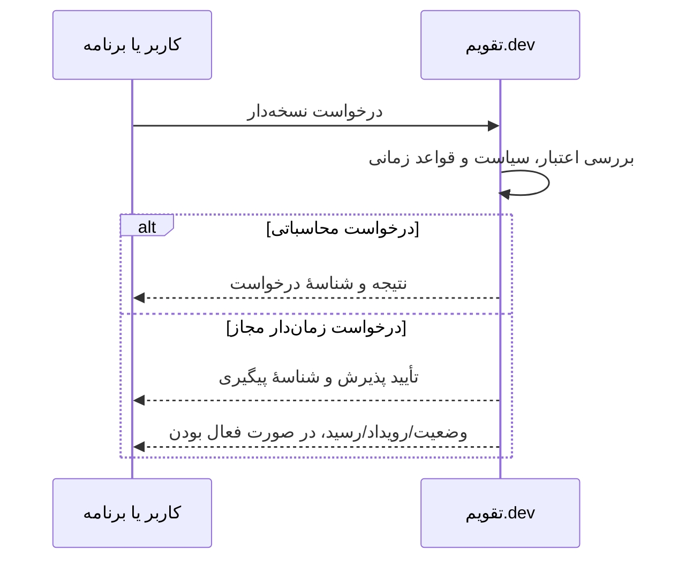

# نقشهٔ قابلیت‌های تقویم.dev

> نقشهٔ محصول، بدون اشاره به زیرساخت، ارائه‌دهندگان خدمات یا جزئیات پیاده‌سازی.

## مدل تعامل

### مرز میان نمایش و سرویس واقعی

- ابزارها و ویجت‌های نمایشی برای آشنایی و آزمایش مفهوم ارائه می‌شوند.
- دسترسی به عملیات واقعی، کلیدها و قابلیت‌های پیشرفته تابع فعال‌شدن حساب و قرارداد محصول است.
- اطلاعات مربوط به تقویم قمری و تعطیلات وابسته به اعلام رسمی ممکن است پیش‌بینی باشند.

[مسیر کاربر](PRODUCT-JOURNEY.md) · [سایت](https://taghvim.dev/)
