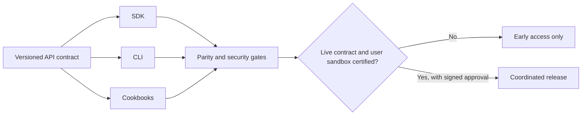

# One coordinated developer release — 2026-10-20

**Current distribution:** public source under Apache-2.0, status PREVIEW.

SDK (JavaScript/TypeScript, Python), CLI and Cookbooks are independently tested but **not independently released as incompatible versions**. The public matrix pins immutable Git commits and a single exact 46-operation API contract.

## Execution rules

1. API contract changes update all public repositories in a coordinated release bundle. Update the `PUBLIC-RELEASE-MATRIX.json` with exact new tested commit SHAs.
2. Every matrix PR checks out those immutable SHA revisions (never unstable latest) and verifies deep equality of the operation index, API version, admin-operation exclusion and total operation set.
3. Before any GA announcement, run `coordinated-public-release` manually with `verify_live: true` **after** the compatible deployments. The gate fails on any website/API mismatch.
4. Public contract parity is necessary, **not sufficient**: complete real user signup and email verification, test tenant/keys, actual sandbox requests, quotas/metering, tenant isolation, failure recovery, migration and operator approvals.
5. Keep a durable evidence chain: code SHA ↔ requirements ↔ tests ↔ CI run ↔ deployed version ↔ approved release, including reverse impact checks. Superseded runs are not active incidents; never mute active failures.
6. Promotion to GA, charging users or turning on self-service signup must not happen only because unit tests passed.

### Observed blocker

A read-only public probe on 2026-10-20 saw deployed API **2.0.0** and public SDK/CLI/Cookbooks targeting **2.1.0**; Landing and API OpenAPI JSON did not match. See observation run `39426745433`. Release state stays **BLOCKED** until new proof is collected.

### Maintaining clear source ownership

Canonical API definition belongs to the governed API product. SDK/CLI/Cookbooks are public, independently usable projections of its approved contract, not separate sources of truth. Public organization docs link to those repos and avoid duplicating their runtime source code. The infrastructure and subprocessor inventory remains private.
