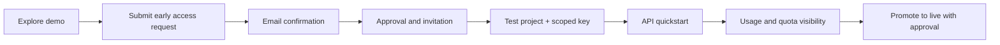

# Developer onboarding (early access)

## 🧪 ثبت‌نام و دریافت کلید آزمایشی ۳۰روزه | Early Access

**[درخواست API Key](https://taghvim.dev/#access)** · [Register for API access](https://taghvim.dev/#access)

با ثبت‌نام در فهرست دسترسی زودهنگام، پیام تأیید به ایمیل شما ارسال می‌شود. پس از **۷ روز** و تنها پس از فعال‌سازی کنترل‌شدهٔ سرویس، دعوت‌نامهٔ یک‌بارمصرف (معتبر برای **۷۲ ساعت**) می‌تواند به ایمیل ثبت‌شده ارسال شود. پس از قبول دعوت، Tenant آزمایشی و کلید تست با **۳۰ روز اعتبار از لحظهٔ فعال‌سازی** صادر می‌شود. مدت انتظار ۷روزه از دوره آزمایشی کم نمی‌شود. هیچ کلیدی در ایمیل یا GitHub قرار نمی‌گیرد؛ ارسال‌های بازاریابی نیز رضایت جداگانه لازم دارند.

**English:** [Sign up here](https://taghvim.dev/#access). Acknowledgement comes first; after seven days the invitation is eligible for scheduled delivery, subject to rollout and deliverability gates. The invitation expires after 72 hours; a successfully activated trial API key lasts 30 days **from activation**. This is test access, not automatic production approval. [Privacy](https://taghvim.dev/#privacy) · [Terms](https://taghvim.dev/#terms).

**Availability:** Public self-service sign-up and production tenant/key issuance have not been independently verified. The current public form is an invitation/waitlist form; do not mistake its submission receipt for API access.

## Journey

Stage **D onward** requires operational enablement and an authorized service. Never display a fabricated API token to an unapproved visitor.

## Access-safety rules
- Isolate test and live credentials and tenants. Never ship operator credentials in examples.
- Keys must be masked, revocable and never logged; sandbox quotas and usage must be visible and measurable.
- Separate consent for product updates/distribution email from necessary replies to access requests; track consent version, timestamp, revocation and suppression.
- Before GA: prove live deployment identity, OpenAPI compatibility, protected branches, negative-path tenancy tests, quota and ledger reconciliation, delivery, backup and rollback.

See [API Quickstart](API-QUICKSTART.md) and [Cookbooks](COOKBOOKS.md).
