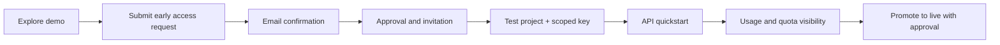

# Developer onboarding (early access)

**Availability:** Public self-service sign-up and production tenant/key issuance have not been independently verified. The current public form is an invitation/waitlist form; do not mistake its submission receipt for API access.

## Journey

Stage **D onward** requires operational enablement and an authorized service. Never display a fabricated API token to an unapproved visitor.

## Access-safety rules
- Isolate test and live credentials and tenants. Never ship operator credentials in examples.
- Keys must be masked, revocable and never logged; sandbox quotas and usage must be visible and measurable.
- Separate consent for product updates/distribution email from necessary replies to access requests; track consent version, timestamp, revocation and suppression.
- Before GA: prove live deployment identity, OpenAPI compatibility, protected branches, negative-path tenancy tests, quota and ledger reconciliation, delivery, backup and rollback.

See [API Quickstart](API-QUICKSTART.md) and [Cookbooks](COOKBOOKS.md).
