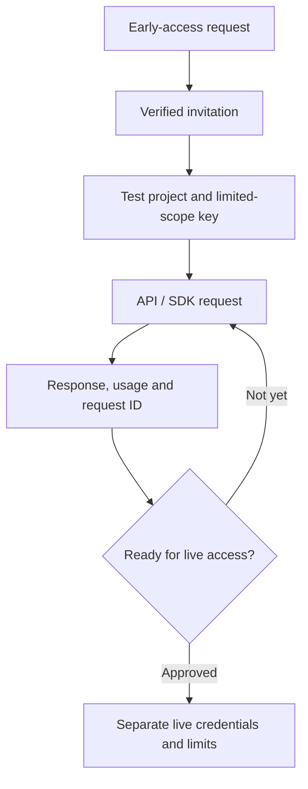

# Developer quickstart | شروع توسعه با تقویم.dev

**Availability: invitation-based early access.** Live developer accounts, keys, and SDK publishing are not yet generally available. Examples below describe the API contract and should be run only after you receive an authorized test key.

## First request

```bash
curl --fail-with-body https://api.taghvim.dev/v1/dates/convert \
  -H "Authorization: Bearer $TAGHVIM_TEST_API_KEY" \
  -H "Content-Type: application/json" \
  -d '{"date":"1405-07-15"}'
```

For authenticated requests, use your private **test** token, not a production credential. Do not paste credentials into browser consoles, public issue reports, or shared screenshots. The endpoint may not be publicly provisioned yet.

## API and SDK lifecycle



- The canonical API specification and the SDK preview are versioned in the private `engine` repository.
- The public examples and cookbooks intentionally avoid secret values, provider names, architectural internals and subprocessor disclosures.
- Authentication, test quotas, failure and retry behavior must be validated against a deployed revision before using the SDK in production.

[Cookbooks](COOKBOOKS.md) · [API life cycle](API-LIFECYCLE.md) · [Support](../SUPPORT.md)
