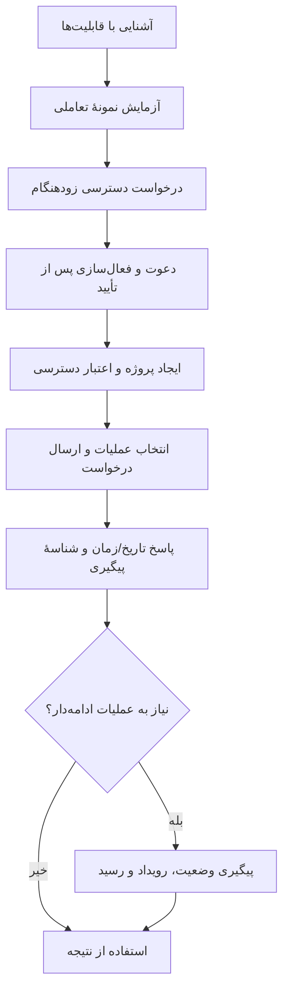
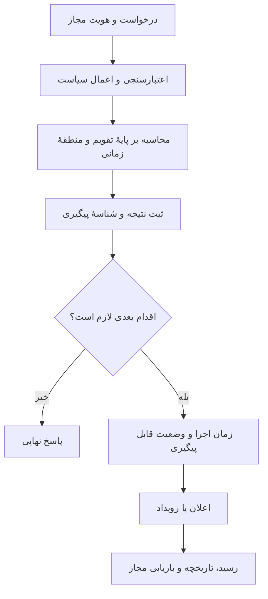

# مسیر استفاده از تقویم.dev

> این سند مسیر مفهومی محصول را نشان می‌دهد، نه جزئیات استقرار یا ادعای در دسترس بودن تمام مراحل. **وضعیت کنونی: دسترسی زودهنگام.**

## از آشنایی تا استفاده

**توجه:** مراحل دعوت، ساخت پروژه، صدور اعتبار دسترسی و اجرای عملیات حفاظت‌شده، تنها پس از فعال‌سازی رسمی برای کاربر قابل استفاده‌اند. ابزارهای تعاملی صفحه شامل نمونه‌های نمایشی نیز هستند.

## چرخهٔ یک عملیات زمان‌دار

این دیاگرام‌ها **رفتار مورد انتظار محصول** هستند و تضمین اجرای همهٔ بخش‌ها در محیط عمومی محسوب نمی‌شوند. نمونه‌های آزمایشی باید به‌وضوح از عملیات واقعی جدا شوند.

[قابلیت‌ها](CAPABILITY-MAP.md) · [وب‌سایت](https://taghvim.dev/)
