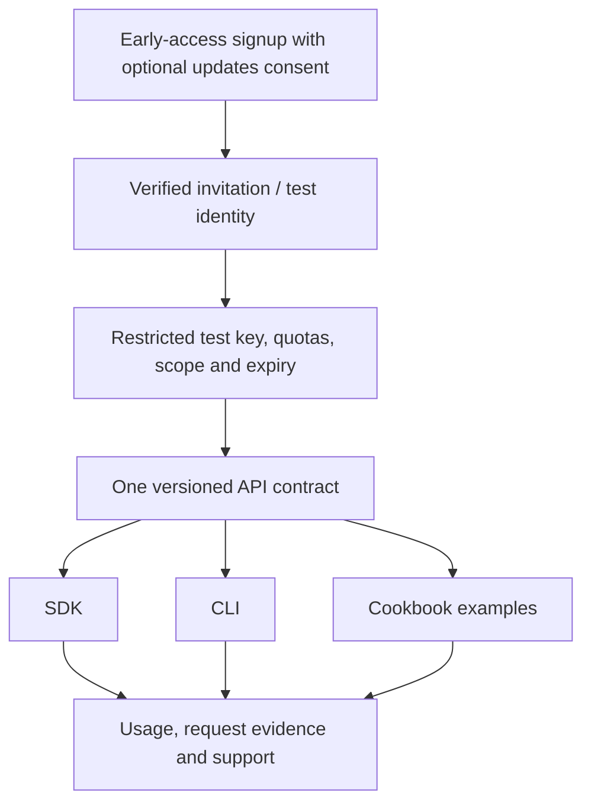

# Public developer release — canonical, cohesive and auditable

The canonical public API surface is the versioned 46-operation registry in [contracts/operation-index.json](../contracts/operation-index.json), derived from the corresponding approved Engine contract. SDK, CLI and Cookbooks are standalone source repositories, **not copies under the organization profile**.

## One public product journey

## Release gate and notification policy

1. Update the canonical Engine contract and verify source hash and actual deployed API version.
2. Reconcile the exact public operation index across the organization, SDK, CLI and Cookbooks; each project retains local PR checks and immutable dependencies.
3. Run [public-developer-release-parity](../.github/workflows/public-release-parity.yml) on demand or at a public release tag, **not on each intermediate commit**, to prevent failures cascading between repos.
4. Validate real SDK tests, CLI and Cookbook examples with mocked transport. No live API key is needed for CI.
5. Save SHA evidence, status, compatible SDK/CLI versions, rights/IP/OSS licence, test run, release approval and rollback.
6. Require sandbox invitation, authorization isolation, migration, meter/ledger parity, rate-limit, privacy, email delivery and payment activation evidence before changing product availability claims.
7. Documentation and Persian copy must match current capabilities. Use explicit `dir="rtl"` for Persian HTML, `dir="ltr"` for identifiers, URLs and commands. Do not auto-reverse or transliterate source strings.

**Release-only parity is not an excuse to accept drift:** an intentional API change must update all four public manifests before a release tag is approved. The tag-to-commit mapping is captured in evidence. Normal source PRs must pass their own tests first.

The public product site and organization profile do not disclose internal infrastructure, implementation stack or service providers.
