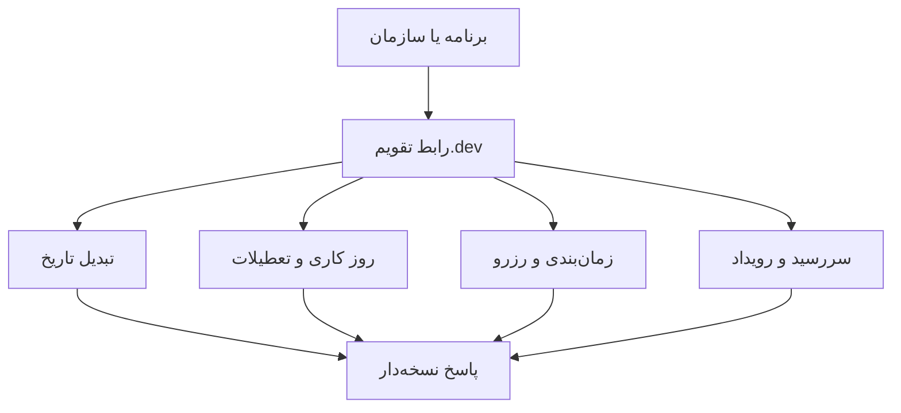

<h1 align="center" dir="rtl" lang="fa">تقویم.dev™ | Taghvim.dev</h1>

<strong>زیرساخت برنامه‌پذیر زمان برای محصولات ایرانی</strong>

<strong>Build with time. Not around it.</strong>

تقویم شمسی، میلادی و قمری، روزهای کاری، تعطیلات، سررسید، زمان‌بندی و رزرو؛ همه با یک مدل زمانی هماهنگ و رابط‌های نسخه‌دار.

<a href="https://taghvim.dev/">وب‌سایت</a> · <a href="https://taghvim.dev/#api-explorer">مرجع API</a> · <a href="https://taghvim.dev/#playground">آزمایشگاه تاریخ</a> · <a href="https://taghvim.dev/#access">دسترسی زودهنگام</a>

## ثبت‌نام دسترسی آزمایشی — مسیر رسمی مشترک

برای دریافت کلید API، از <a href="https://taghvim.dev/#access">فرم رسمی دسترسی زودهنگام تقویم.dev</a> ثبت‌نام کنید. درخواست شما در فهرست واحد Early Access ثبت و ایمیل تأیید ارسال می‌شود. <strong>از ۷ روز پس از ثبت‌نام</strong>، در صورت آماده‌بودن سرویس و نبود انصراف یا مسدودسازی، دعوت‌نامهٔ اختصاصی ارسال می‌شود؛ پیوند آن <strong>۷۲ ساعت</strong> معتبر است. بعد از پذیرش دعوت‌نامه، Tenant مستقل و کلید آزمایشی ساخته می‌شود؛ <strong>دورهٔ آزمایشی کامل ۳۰روزه از لحظهٔ فعال‌سازی آغاز می‌شود</strong>، نه از تاریخ ثبت‌نام یا ارسال دعوت‌نامه. چرخش کلید، پایان این دوره را عقب نمی‌اندازد. نیازی به کارت بانکی نیست و دسترسی Production صادر نمی‌شود.

خبرهای محصول فقط با رضایت جداگانه و اختیاری ارسال می‌شوند. کلید API در ایمیل فرستاده نمی‌شود و فقط هنگام فعال‌سازی یک‌بار نمایش داده می‌شود. <a href="https://taghvim.dev/#privacy">حریم خصوصی</a> · <a href="https://taghvim.dev/#terms">شرایط</a> · <a href="https://api.taghvim.dev/developer">پذیرش دعوت‌نامه</a> · <a href="https://api.taghvim.dev/openapi.json">OpenAPI</a>. صدور دعوت‌نامه تابع آمادگی عملیاتی سرویس است؛ صرفِ ثبت درخواست کلید صادر نمی‌کند.

## چه مسئله‌ای را حل می‌کنیم؟

از تبدیل تاریخ و محاسبهٔ روزهای کاری تا برنامه‌ریزی و سررسید، همهٔ رابط‌های محصول بر یک تعریف سازگار از زمان تکیه می‌کنند.

## شروع برای توسعه‌دهندگان

کتابخانه‌ها، ابزار خط فرمان و نمونه‌های کاربردی، مخازن مستقل و متن‌باز هستند؛ همگی به یک قرارداد نسخه‌دار متصل‌اند و با مجوز Apache-2.0 ارائه می‌شوند.

- [SDK رسمی JavaScript/TypeScript و Python](https://github.com/Taghvim-dev/SDK)
- [CLI — ابزار خط فرمان](https://github.com/Taghvim-dev/CLI)
- [Cookbooks و مثال‌های قابل اجرا](https://github.com/Taghvim-dev/cookbooks)
- [راهنمای شروع و وضعیت دسترسی](../docs/DEVELOPER-ONBOARDING.md) · [Quickstart API](../docs/API-QUICKSTART.md)
- [قرارداد عمومی نسخه‌دار](../contracts/operation-index.json) · [راهنمای انتشار هماهنگ](../docs/PUBLIC-DEVELOPER-RELEASE.md)
- [پشتیبانی](../SUPPORT.md) · [امنیت](../SECURITY.md) · [مالکیت فکری و OSS](../IP-AND-OSS.md)

<strong>وضعیت: دسترسی زودهنگام.</strong> نمونه‌های تعاملی صفحه لزوماً عملیات واقعی حساب کاربری نیستند. دسترسی آزمایشی به API فقط پس از دعوت و فعال‌سازی فراهم می‌شود. <strong>ثبت درخواست به‌معنای صدور فوری کلید نیست.</strong>

## برای چه محصولاتی؟

نرم‌افزارهای سازمانی، تجارت و خدمات، مالی، درمان، لجستیک، حقوق و منابع انسانی. پشتیبانی از زنجیرهٔ چندسطحی B2B2B2C در برنامهٔ محصول قرار دارد؛ این متن ادعای تکمیل آن در نسخهٔ فعلی نیست.

---

**English:** Taghvim.dev offers programmable calendar and time capabilities. [Request early access](https://taghvim.dev/#access), then explore [developer documentation](https://github.com/Taghvim-dev/SDK).

Public developer documentation and examples in this repository: Apache-2.0. Trademarks reserved; see [NOTICE](../NOTICE).
