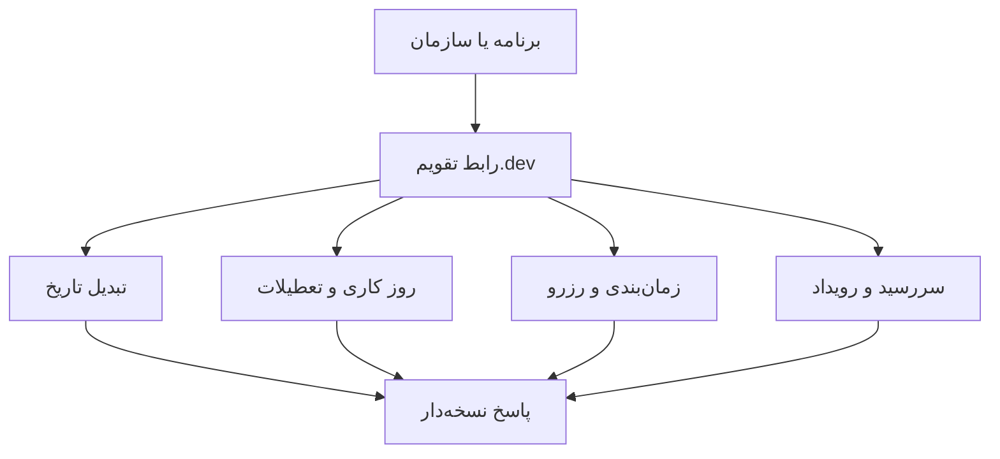

<h1 align="center" dir="rtl" lang="fa">تقویم.dev™ | Taghvim.dev</h1>

## 🧪 درخواست API Key و آزمایش رایگان ۳۰روزه | 30-day developer trial

**[ثبت‌نام برای دریافت API Key آزمایشی](https://taghvim.dev/#access)** · **[Request an API test key](https://taghvim.dev/#access)**

با ثبت درخواست دسترسی زودهنگام، ایمیل تأیید دریافت می‌کنید. پس از **۷ روز**، در صورت آماده‌بودن سرویس و برقرار بودن شرایط دسترسی، دعوت‌نامهٔ یک‌بارمصرف به همان ایمیل فرستاده می‌شود. پیوند دعوت تا **۷۲ ساعت** اعتبار دارد. پس از فعال‌سازی دعوت‌نامه، Tenant آزمایشی و کلید `tgv_test_...` صادر می‌شود که **۳۰ روز از زمان فعال‌سازی** معتبر است (نه از زمان ثبت‌نام). کلید فقط یک‌بار در صفحه فعال‌سازی نمایش داده می‌شود؛ هرگز در GitHub، کد کلاینت یا Issue عمومی قرار ندهید. تمدید یا دسترسی Production نیازمند تأیید جداگانه است.

**English:** Register on the official early-access form and receive an acknowledgement email. The seven-day invitation schedule is activated only after the protected Cloudflare release and email-delivery checks. An emailed one-time invitation (72-hour validity) provisions a test tenant and a **30-day test API key starting on activation**. An invitation is not itself an API key. Product-update emails use a separate, optional consent choice. [Privacy](https://taghvim.dev/#privacy) · [Terms](https://taghvim.dev/#terms) · [Contact](https://taghvim.dev/#contact).

<strong>زیرساخت برنامه‌پذیر زمان برای محصولات ایرانی</strong>

<strong>Build with time. Not around it.</strong>

تقویم شمسی، میلادی و قمری، روزهای کاری، تعطیلات، سررسید، زمان‌بندی و رزرو؛ همه با یک مدل زمانی هماهنگ و رابط‌های نسخه‌دار.

<a href="https://taghvim.dev/">وب‌سایت</a> · <a href="https://taghvim.dev/#api-explorer">مرجع API</a> · <a href="https://taghvim.dev/#playground">آزمایشگاه تاریخ</a> · <a href="https://taghvim.dev/#access">دسترسی زودهنگام</a>

## چه مسئله‌ای را حل می‌کنیم؟

از تبدیل تاریخ و محاسبهٔ روزهای کاری تا برنامه‌ریزی و سررسید، همهٔ رابط‌های محصول بر یک تعریف سازگار از زمان تکیه می‌کنند.

## 🧪 دریافت API Key و دورهٔ آزمایشی ۳۰روزه | 30-day API trial

**[ثبت‌نام برای دریافت API Key آزمایشی](https://taghvim.dev/#access)** · **[Request API access](https://taghvim.dev/#access)**

در فرم رسمی دسترسی زودهنگام ثبت‌نام کنید تا تأییدیهٔ ثبت درخواست را با ایمیل دریافت کنید. از <strong>۷ روز پس از ثبت‌نام</strong> و پس از احراز آمادگی سرویس، دعوت‌نامهٔ اختصاصی به همان نشانی فرستاده می‌شود. پیوند دعوت‌نامه <strong>۷۲ ساعت و یک‌بارمصرف</strong> است. پس از فعال‌سازی آن، یک Tenant مستقل و کلید <code>tgv_test_…</code> دریافت می‌کنید. <strong>دورهٔ آزمایشی دقیقاً ۳۰ روز از زمان فعال‌سازی شروع می‌شود</strong>؛ تعویض کلید باعث تمدید آن نمی‌شود. کلید در صفحهٔ فعال‌سازی فقط یک بار نمایش داده می‌شود. پس از پایان دوره، دسترسی نیازمند تأیید جدید است؛ حساب یا کلید Production به‌طور خودکار صادر نمی‌شود.

**English:** [Join the early-access waitlist](https://taghvim.dev/#access) → registration confirmation email → eligibility for a one-time emailed invitation **after seven days**, once the protected email and API services are ready → activate the invitation **within 72 hours** → receive a test-only API key and a **30-day trial counted from activation, not registration**. Rotating keys does not reset this deadline. Do not commit API keys, publish them in GitHub issues, or place shared secrets in public browser code. Product announcements require a separate optional opt-in.

[Developer activation portal](https://api.taghvim.dev/developer) · [Test-key console](https://api.taghvim.dev/developer/console) · [API contract](https://api.taghvim.dev/openapi.json) · [Privacy](https://taghvim.dev/#privacy) · [Terms](https://taghvim.dev/#terms) · [Contact](https://taghvim.dev/#contact)

> **Current availability:** The public form collects early-access requests. Timed invitation delivery is not guaranteed until the Landing D1 migration, protected Engine Cron deployment and real email-delivery checks have passed. A signup acknowledgement is not an API key.

## شروع برای توسعه‌دهندگان

کتابخانه‌ها، ابزار خط فرمان و نمونه‌های کاربردی، مخازن مستقل و متن‌باز هستند؛ همگی به یک قرارداد نسخه‌دار متصل‌اند و با مجوز Apache-2.0 ارائه می‌شوند.

- [SDK رسمی JavaScript/TypeScript و Python](https://github.com/Taghvim-dev/SDK)
- [CLI — ابزار خط فرمان](https://github.com/Taghvim-dev/CLI)
- [Cookbooks و مثال‌های قابل اجرا](https://github.com/Taghvim-dev/cookbooks)
- [راهنمای شروع و وضعیت دسترسی](../docs/DEVELOPER-ONBOARDING.md) · [Quickstart API](../docs/API-QUICKSTART.md)
- [قرارداد عمومی نسخه‌دار](../contracts/operation-index.json) · [راهنمای انتشار هماهنگ](../docs/PUBLIC-DEVELOPER-RELEASE.md)
- [پشتیبانی](../SUPPORT.md) · [امنیت](../SECURITY.md) · [مالکیت فکری و OSS](../IP-AND-OSS.md)

<strong>وضعیت: دسترسی زودهنگام.</strong> نمونه‌های تعاملی صفحه لزوماً عملیات واقعی حساب کاربری نیستند. دسترسی آزمایشی به API فقط پس از دعوت و فعال‌سازی فراهم می‌شود. <strong>عضویت در فهرست انتظار به‌معنای صدور خودکار کلید نیست.</strong>

## برای چه محصولاتی؟

نرم‌افزارهای سازمانی، تجارت و خدمات، مالی، درمان، لجستیک، حقوق و منابع انسانی. پشتیبانی از زنجیرهٔ چندسطحی B2B2B2C در برنامهٔ محصول قرار دارد؛ این متن ادعای تکمیل آن در نسخهٔ فعلی نیست.

---

**English:** Taghvim.dev offers programmable calendar and time capabilities. [Request early access](https://taghvim.dev/#access), then explore [developer documentation](https://github.com/Taghvim-dev/SDK).

Public developer documentation and examples in this repository: Apache-2.0. Trademarks reserved; see [NOTICE](../NOTICE).
