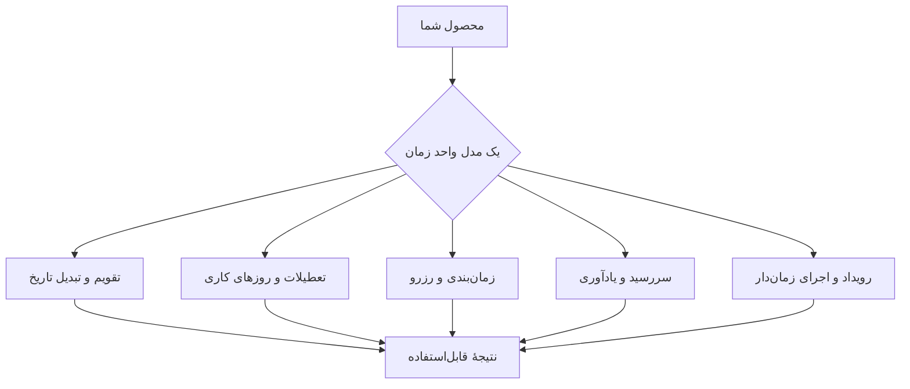

# تقویم.dev™ | Taghvim.dev

### زیرساخت برنامه‌پذیر زمان برای محصولات ایرانی
**Build with time. Not around it.**

تقویم شمسی، میلادی و قمری، روزهای کاری، تعطیلات، سررسید، زمان‌بندی، رزرو و اجرای زمان‌دار — با یک مدل زمانی هماهنگ.

[وب‌سایت](https://taghvim.dev/) · [مرجع API](https://taghvim.dev/#api-explorer) · [آزمایشگاه تاریخ](https://taghvim.dev/#engine) · [شروع رایگان / دسترسی زودهنگام](https://taghvim.dev/#start)

## چه مسئله‌ای را حل می‌کنیم؟

محاسبهٔ تاریخ فقط تبدیل یک روز نیست؛ رویدادهای تکرارشونده، منطقهٔ زمانی، روز کاری، تعطیلی، ضرب‌الاجل، رزرو و یادآوری باید در همهٔ بخش‌های محصول **رفتار سازگار و قابل‌توضیح** داشته باشند.

## برای چه کسانی؟

توسعه‌دهندگان نرم‌افزار، تیم‌های محصول، کسب‌وکارهای مالی، خدمات درمانی، منابع انسانی، حقوقی و عملیات سازمانی؛ هرجا که تصمیم‌ها و فرآیندها به تقویم دقیق وابسته‌اند.

## رابط‌ها و قابلیت‌ها

API نسخه‌دار، ابزارهای توسعه‌دهنده، ویجت‌های آماده و رابط‌های عامل‌های هوشمند؛ قابلیت‌های مختلف به‌صورت تدریجی عرضه می‌شوند. **وضعیت عمومی کنونی: دسترسی زودهنگام.** نمایش نمونه در وب‌سایت به معنای فعال‌بودن همان قابلیت برای همهٔ کاربران نیست.

- [مسیر کاربر و دیاگرام‌های محصول](../docs/PRODUCT-JOURNEY.md)
- [نقشهٔ قابلیت‌ها](../docs/CAPABILITY-MAP.md)
- [پشتیبانی](../SUPPORT.md) · [گزارش محرمانهٔ امنیتی](../SECURITY.md)
- [سیاست مالکیت فکری و متن‌باز](../IP-AND-OSS.md)

---

**English:** Taghvim.dev provides programmable time capabilities for Iranian products, from calendars and business days to deadlines, bookings and scheduled operations. **Early access:** request an invitation on [taghvim.dev](https://taghvim.dev/).

© 2026 Taghvim.dev project authors and respective rights holders. Trademarks and product materials are subject to the [IP/OSS policy](../IP-AND-OSS.md).
