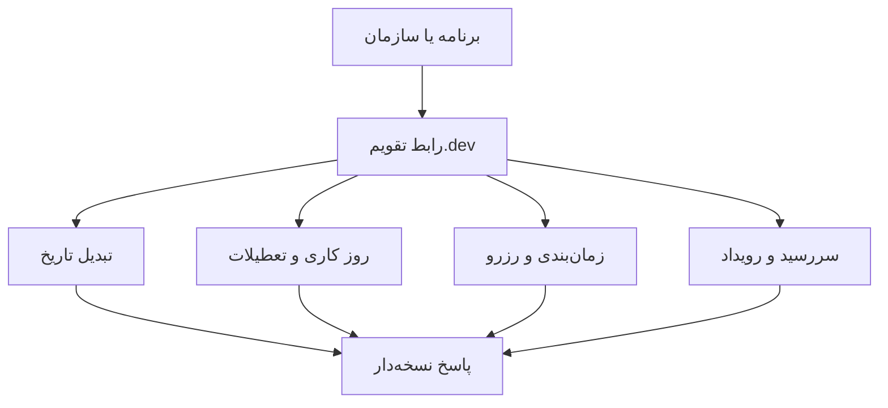

# تقویم.dev™ | Taghvim.dev

### زیرساخت برنامه‌پذیر زمان برای محصولات ایرانی
**Build with time. Not around it.**

قابلیت‌های تقویم شمسی، میلادی و قمری، روزهای کاری، تعطیلات، سررسید، زمان‌بندی و رزرو، با یک مدل هماهنگ و رابط‌های نسخه‌دار.

[وب‌سایت](https://taghvim.dev/) · [مرجع API](https://taghvim.dev/#api-explorer) · [آزمایشگاه تاریخ](https://taghvim.dev/#playground) · [درخواست دسترسی زودهنگام](https://taghvim.dev/#access)

## چه مسئله‌ای را حل می‌کنیم؟
از تبدیل تاریخ و محاسبهٔ روزهای کاری تا برنامه‌ریزی و سررسید، یک تعریف سازگار از زمان در تمام رابط‌های محصول به کار می‌رود.

## شروع برای توسعه‌دهندگان
- [راهنمای شروع و وضعیت دسترسی](../docs/DEVELOPER-ONBOARDING.md)
- [Quickstart برای API](../docs/API-QUICKSTART.md)
- [نمونهٔ JavaScript](../examples/javascript/convert-date.mjs) و [Python](../examples/python/convert_date.py)
- [SDKهای آزمایشی JavaScript و Python](../sdk/README.md) · [Cookbooks](../cookbooks/README.md) · [نقشهٔ قابلیت‌ها](../docs/CAPABILITY-MAP.md)
- [پشتیبانی](../SUPPORT.md) · [امنیت](../SECURITY.md) · [سیاست IP/OSS](../IP-AND-OSS.md)

**وضعیت: دسترسی زودهنگام.** نمونه‌های صفحه لزوماً عملیات واقعی حساب کاربری نیستند. دسترسی آزمایشی به API پس از دعوت و فعال‌سازی امکان‌پذیر است؛ **ثبت‌نام در فهرست انتظار به‌معنای صدور خودکار کلید نیست**.

## برای چه محصولاتی؟
نرم‌افزارهای سازمانی، تجارت و خدمات، مالی، درمان، لجستیک، حقوق و منابع انسانی. پشتیبانی کامل از زنجیره‌های مستقل B2B2B2C یک **هدف محصول** است، نه ادعای پیاده‌سازی کامل فعلی.

---

**English:** Taghvim.dev offers programmable calendar and time capabilities. [Request early access](https://taghvim.dev/#access), then explore [developer documentation](../docs/API-QUICKSTART.md).

Public developer documentation and examples in this repository: Apache-2.0. Trademarks reserved; see [NOTICE](../NOTICE).
